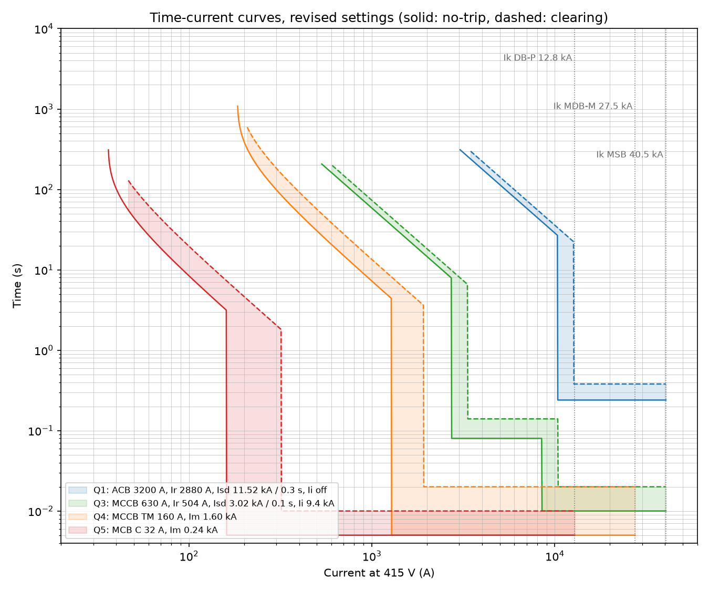

# Short-Circuit, Protection Coordination & Selectivity Study

A fault and protection study for a 2000 kVA, 11/0.433 kV transformer feeding a
main LV switchboard and two levels of downstream distribution:

```
11 kV grid ── T1 2000 kVA ── busduct 12 m ── MSB ──Q3── 2x240 mm2, 60 m ── MDB-M ──Q4── 70 mm2, 45 m ── DB-P ──Q5── 6 mm2, 25 m ── load
S"k 500 MVA   Dyn11, uk 6.25 %    3200 A       │ Q1 ACB 3200 A incomer
(250 MVA min) Pk 20 kW                         │ Q2 ACB 2000 A UPS feeder
```

The study covers:

1. **Short-circuit currents to IEC 60909-0:2016**: maximum and minimum three-phase
   and line-to-earth currents, peak current `ip` and R/X at every bus, using the
   equivalent voltage source method with `c = 1.05 / 0.95` and the transformer
   correction factor `KT`.
2. **Cross-check with pandapower**, an open-source power system tool with its own
   IEC 60909 solver. The same network is built there and the two sets of results
   are compared bus by bus.
3. **Device duty**: breaking capacity `Icu` against the prospective fault, making
   capacity `Icm` against `ip`, and the ACB short-time withstand `Icw` with the
   instantaneous trip switched off.
4. **Time-current selectivity** between each upstream/downstream pair, with
   tolerance bands on every curve, giving the selectivity limit `Is`
   (IEC 60947-2 Annex A).
5. **Automatic disconnection** in the TN system (IEC 60364-4-41) using the
   minimum earth-fault current at the far end of each circuit.

## Running

```bash
pip install -r requirements.txt
python study.py          # prints all tables, writes results/
python -m pytest
```

`results/study_results.xlsx` has one sheet per table below; `results/tcc.png` is
the coordination plot.

## Results

### Fault levels

| Bus | R/X | Ik3 max (kA) | kappa | ip (kA) | Ik1 max (kA) | Ik3 min (kA) | Ik1 min (kA) |
|---|---|---|---|---|---|---|---|
| T1 LV terminals | 0.158 | 41.73 | 1.630 | 96.20 | 42.66 | 34.64 | 35.94 |
| MSB | 0.177 | 40.46 | 1.596 | 91.31 | 40.48 | 33.64 | 34.17 |
| MDB-M | 0.393 | 27.48 | 1.322 | 51.36 | 20.45 | 22.99 | 17.16 |
| DB-P | 1.271 | 12.83 | 1.042 | 18.90 | 7.21 | 9.99 | 5.52 |
| Final circuit end | 6.543 | 2.69 | 1.020 | 3.88 | 1.36 | 1.97 | 0.99 |

`KT = 0.9619`. The prospective fault at the main LV bus is **40.5 kA** (41.7 kA at
the transformer terminals).

### pandapower cross-check

| Bus | Ik3 hand / pandapower (kA) | ip hand / pandapower (kA) | Ik1 hand / pandapower (kA) | Max deviation |
|---|---|---|---|---|
| T1 LV terminals | 41.73 / 41.60 | 96.20 / 95.92 | 42.66 / 42.57 | 0.57 % |
| MSB | 40.46 / 40.34 | 91.31 / 91.06 | 40.48 / 40.40 | 0.55 % |
| MDB-M | 27.48 / 27.42 | 51.36 / 51.28 | 20.45 / 20.43 | 0.36 % |
| DB-P | 12.83 / 12.82 | 18.90 / 18.89 | 7.21 / 7.21 | 0.10 % |
| Final circuit end | 2.69 / 2.69 | 3.88 / 3.88 | 1.36 / 1.36 | 0.01 % |

All values agree within 0.6 %. The small remaining difference is at the stiff end of
the system, where the 11 kV network impedance carries the most weight.

### Device duty

| Device | Fault at device (kA) | Icu (kA) | ip / Icm (kA) | Result |
|---|---|---|---|---|
| Q1 ACB 3200 A | 40.5 | 65 | 91.3 / 143 | OK; Icw 65 kA 1 s covers 40.5 kA for 0.38 s |
| Q2 ACB 2000 A | 40.5 | 65 | 91.3 / 143 | OK |
| Q3 MCCB 630 A | 40.5 | 50 | 91.3 / 105 | OK |
| Q4 MCCB 160 A | 27.5 | 36 | 51.4 / 75.6 | OK |
| Q5 MCB 32 A | 12.8 | 10, revised to 15 | - | **first pass failed** |

The first pass used a standard 10 kA MCB at DB-P, which is below the 12.8 kA
available there. The revised design uses a 15 kA (IEC 60947-2) device; the
alternative is a 10 kA MCB backed up by Q4 using the maker's cascading tables.

### Selectivity

| Pair | Ik at downstream device | First pass | Revised |
|---|---|---|---|
| Q1 ACB 3200 A / Q3 MCCB 630 A | 40.5 kA | total | total |
| Q3 MCCB 630 A / Q4 MCCB 160 A | 27.5 kA | Is = 5.7 kA | Is = 8.5 kA |
| Q4 MCCB 160 A / Q5 MCB 32 A | 12.8 kA | Is = 1.3 kA | Is = 1.3 kA |

- **Q1/Q3** is fully selective because Q1 has its instantaneous trip off and a
  0.3 s short-time delay, which its 65 kA / 1 s `Icw` rating allows. Q3 clears
  everything below Q1's short-time band.
- **Q3/Q4**: raising Q3's instantaneous pickup from 10 x In to 15 x In moved the
  limit from 5.7 kA to 8.5 kA. Above that, both devices are in their instantaneous
  zones and the curves alone can't prove selectivity. The 27.5 kA case needs the
  maker's energy-based selectivity table for the chosen pair.
- **Q4/Q5**: the curves give selectivity up to Q4's lowest magnetic threshold
  (1.28 kA). The maximum fault at the end of the final circuit is 2.7 kA, so faults
  close to DB-P depend on the maker's MCCB/MCB tables. This is the usual situation
  for thermal-magnetic MCCBs over MCBs.



### Automatic disconnection (TN, 230 V to earth)

| Device | Circuit end | Ik1 min (kA) | Needed to clear in time (kA) | Clearing time | Limit |
|---|---|---|---|---|---|
| Q3 | MDB-M | 17.16 | 3.33 | 0.02 s | 5 s |
| Q4 | DB-P | 5.52 | 1.63 | 0.02 s | 5 s |
| Q5 | final circuit end | 0.99 | 0.32 | 0.01 s | 0.4 s |

## Method notes

- Impedances are referred to the LV side. The network feeder is
  `ZQ = c Un^2 / S"kQ / tr^2` with R/X = 0.1. The transformer is
  `ZT = uk Ur^2 / Sr`, `RT = Pk Ur^2 / Sr^2`, corrected by
  `KT = 0.95 cmax / (1 + 0.6 xT)` for maximum currents only (clause 6.3.3).
- Maximum currents: `cmax = 1.05` (LV, +6 % tolerance), conductors at 20 degC,
  source at 500 MVA. Minimum currents: `cmin = 0.95`, conductors at 80 degC, source
  at 250 MVA.
- `ip = kappa * sqrt(2) * Ik"` with `kappa = 1.02 + 0.98 e^(-3R/X)` (radial network).
- Line-to-earth: `Ik1 = sqrt(3) c Un / |2 Z1 + Z0|`. The Dyn11 transformer blocks
  the HV zero sequence; `Z0T = ZT`; cable `Z0` is taken as 4 x `Z1`, which
  represents the return through a neutral/PE of the same size.
- Breaker curves are generic models with tolerance bands, not a specific maker's
  data. Electronic trip units use `t = tr (6 Ir / I)^2` for long time, with
  definite-time short-time and instantaneous zones. Thermal-magnetic devices use a
  bimetal heating law with IEC 60947-2 / 60898-1 conventional currents.

## Layout

```
scstudy/iec60909.py     fault calculation
scstudy/devices.py      trip-curve models (electronic LSI, thermal-magnetic, MCB)
scstudy/selectivity.py  selectivity limit between two devices
scstudy/pp_check.py     the same network in pandapower
scstudy/system.py       network data and device settings (first pass and revised)
study.py                runs everything and writes results/
tests/                  hand-checked values, pandapower agreement, IEC 60898 curve points
```
